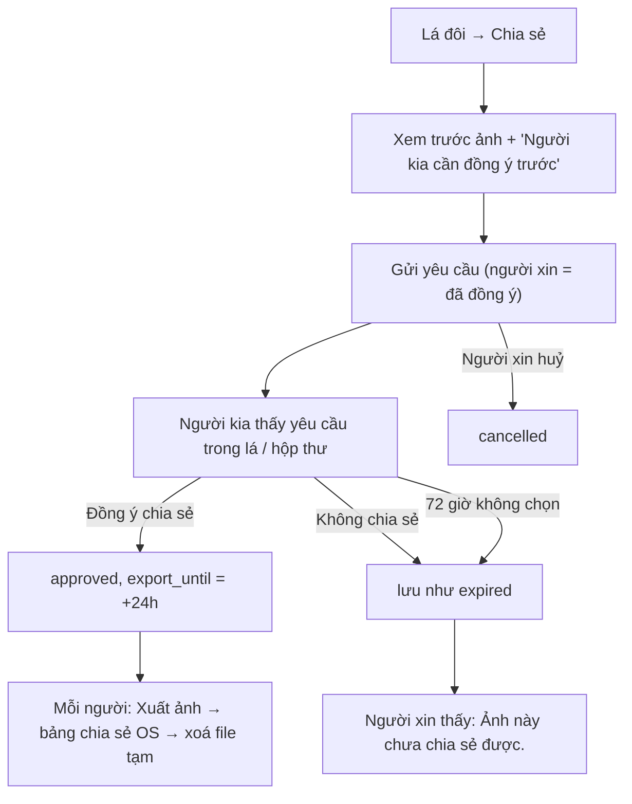

# G53 — Chia sẻ ảnh lá đôi khi cả hai đồng ý

> Trạng thái: nháp 26/10/2026, chờ owner duyệt. Không code ở giai đoạn này.
> Nguồn: [PRD Tri Kỷ](../../foundation/game-line/tri-ky-prd.md) §4 bước 7, TK-8; [SRS](../../foundation/game-line/tri-ky-srs.md) FR-TK-060–066, §10.

## 1. User story

Là một thành viên của cặp Tri Kỷ, tôi muốn chia sẻ ảnh lá đôi ra ngoài chỉ khi người kia cũng đồng ý với đúng ảnh đó, để không ai bị đưa chuyện riêng ra ngoài mà không biết.

## 2. Mục tiêu và ranh giới

**Trong phạm vi:** xin chia sẻ; xem trước đúng ảnh; người kia đồng ý hoặc không; hết hạn im lặng; xuất ảnh qua bảng chia sẻ OS trong 24 giờ sau khi duyệt; huỷ yêu cầu.

**Ngoài phạm vi:** link công khai; trang xem trước có OG tag; ảnh có cung/nguyên tố/ngày; chia sẻ tự động lên mạng xã hội; lưu ảnh trên server.

## 3. Actor, điều kiện và output

- **Actor:** người xin (một thành viên) và người duyệt (thành viên còn lại).
- **Điều kiện:** cặp `active`; không có yêu cầu nào đang chờ.
- **Output:** `tri_ky_share_requests` với `approved` và `export_until`, hoặc `expired`/`cancelled` (hàng vận hành, xoá 7 ngày sau trạng thái cuối); một hàng `tri_ky_share_consents` cho mỗi lần một thành viên đồng ý (bằng chứng, giữ khi lá còn). Ảnh dựng trên máy, không lưu server.

## 4. Luồng

## 5. UI/UX

| Màn | Nội dung |
|---|---|
| Xem trước | Ảnh đúng như sẽ xuất: "Tri Kỷ", hai tên hiển thị, nhãn kiểu, một câu "điều chung". Ghi chú: "Ảnh đã chia sẻ ra ngoài thì Lá Lành không thu lại được." |
| Yêu cầu tới | "[Tên kia] muốn chia sẻ ảnh lá đôi này. Bạn đồng ý không?" + ảnh + "Đồng ý chia sẻ" · "Không chia sẻ" (cùng kích thước) |
| Sau duyệt | "Xuất ảnh" cho cả hai trong 24 giờ |
| Không thành | "Ảnh này chưa chia sẻ được." (không lý do) |

Không đếm ngược 72 giờ trên màn. Không push nhắc người duyệt.

## 6. Business rules

1. Một yêu cầu đang chờ mỗi cặp; tối đa 3 yêu cầu/cặp/ngày.
2. Người xin tạo yêu cầu = đồng ý `tri-ky-share-v1` cho ảnh đó; người kia phải bấm đồng ý cho đúng `layout_version` và đúng projection hiện tại.
3. "Không chia sẻ" lưu thành `expired`; người xin không phân biệt được với hết hạn.
4. Lá dựng lại (hồ sơ đổi) hoặc tên hiển thị đổi sau khi duyệt → duyệt mất hiệu lực, phải xin lại.
5. Ảnh chỉ gồm các phần ở §5; câu "điều chung" phải qua gate không nhắc cung, nguyên tố, ngày, tháng sinh (TK-8).
6. Không URL, QR, ID, watermark có định danh.
7. Ảnh dựng trên máy; file tạm ở cache dir, xoá sau khi bảng chia sẻ đóng; web: tải ảnh qua `blob:` không lưu server.
8. Không push nội dung; mục yêu cầu trong lá/hộp thư trong app có thể hiện tên người kia.
9. Mỗi lần đồng ý (người xin khi tạo yêu cầu; người kia khi bấm "Đồng ý chia sẻ") ghi một bằng chứng `tri_ky_share_consents`: thành viên, thời điểm, phiên bản câu chữ, `layout_version`, `card_hash`; không ảnh, không câu, không tên (FR-TK-067).
10. Hàng yêu cầu chia sẻ xoá 7 ngày sau trạng thái cuối; bằng chứng đồng ý không xoá theo, mà sống khi lá còn.
11. Giải tán hoặc xoá hồ sơ xoá mọi yêu cầu **và** mọi bằng chứng đồng ý của cặp (G54). Có phải giữ bằng chứng lâu hơn lá không: chờ counsel (Q-L7).

## 7. Dữ liệu và API

`POST /v1/tri-ky/pairs/{id}/share-requests`, `GET .../share-requests/current`, `POST /v1/tri-ky/share-requests/{id}/approve|decline|cancel` (SRS §12). Bảng `tri_ky_share_requests` và `tri_ky_share_consents` (SRS §6.3).

## 8. Acceptance Criteria

- **G53-AC01:** Given chưa có duyệt của người kia, When người xin bấm "Xuất ảnh", Then không có ảnh nào được xuất và server không có `export_until`.
- **G53-AC02:** Given người kia bấm "Không chia sẻ", When người xin xem, Then thấy đúng màn như khi hết 72 giờ, không thông báo, không lý do.
- **G53-AC03:** Given yêu cầu được duyệt, When một trong hai xuất trong 24 giờ, Then ảnh xuất ra đúng ảnh đã duyệt; sau 24 giờ nút xuất biến mất.
- **G53-AC04:** Given ảnh xuất, When kiểm nội dung (fixture), Then không có ngày, cung, nguyên tố, URL, QR, ID (T-TK-14).
- **G53-AC05:** Given lá dựng lại hoặc tên đổi sau khi duyệt, When xuất, Then bị chặn và phải xin lại.
- **G53-AC06:** Given yêu cầu đang chờ, When tạo yêu cầu thứ hai, Then 409.
- **G53-AC07:** Given luồng chia sẻ chạy xong, When kiểm server và log, Then không có file ảnh, URL công khai hay nội dung ảnh.
- **G53-AC08:** Given native, When bảng chia sẻ đóng, Then file tạm đã bị xoá khỏi cache dir.
- **G53-AC09:** Given bất kỳ trạng thái nào, When rà push, Then không có push nào cho yêu cầu chia sẻ.
- **G53-AC10:** Given hai thành viên đã đồng ý một ảnh, When kiểm DB, Then có đúng hai hàng `tri_ky_share_consents` (mỗi người một) với phiên bản câu chữ, `layout_version`, `card_hash`, không ảnh/câu/tên; Given 7 ngày sau trạng thái cuối, When dọn dẹp chạy, Then hàng yêu cầu chia sẻ mất còn hai hàng bằng chứng vẫn còn; Given giải tán, Then cả hai hàng bằng chứng bị xoá (T-TK-24).

## 9. Edge cases

| Tình huống | Xử lý |
|---|---|
| Người duyệt mở yêu cầu sau khi người xin đã huỷ | "Yêu cầu này không còn." |
| Giải tán khi yêu cầu đang chờ | Yêu cầu bị xoá cùng lá |
| Người duyệt chụp màn hình thay vì đồng ý | Ngoài kiểm soát; copy không hứa chặn chụp màn hình |
| Hai người cùng xin một lúc | Một yêu cầu thắng; người kia thấy yêu cầu đang có |

## 10. Test matrix

Xin/duyệt/không chia sẻ/hết hạn/huỷ; race hai người xin; lá dựng lại sau duyệt; ảnh fixture; file tạm native; push không có; header `no-store`.

## 11. Analytics

Bộ đếm `share_requested`, `share_approved` (SRS §10). Không ID, không nội dung.

## 12. Definition of Done

- G53-AC01–AC10 pass; T-TK-13, T-TK-14, T-TK-24 pass.
- Layout ảnh và copy được owner duyệt (TK-8).
- **Riêng tư/store:** data map ghi hàng yêu cầu chia sẻ (7 ngày sau trạng thái cuối) và bằng chứng đồng ý chia sẻ (khi lá còn) là dữ liệu linked; ghi rõ ảnh do người dùng tự xuất, Lá Lành không chia sẻ cho bên thứ ba và không lưu ảnh; chính sách quyền riêng tư nói ảnh ra ngoài không thu lại được.
- Evidence native share sheet và xoá file tạm — `[Pending]`.

## 13. Phụ thuộc, riêng tư và evidence

- **Phụ thuộc:** G52; TK-8.
- Chia sẻ ra ngoài là công bố dữ liệu suy luận về hai người; vì vậy cần đồng ý của cả hai cho từng ảnh.
- Evidence: `[Pending] native share QA`, `[Pending] owner layout approval`.

## 14. Bàn giao theo AGENTS.md

Nguồn: PRD/SRS Tri Kỷ, US-05 (mô hình share link hiện có, không dùng lại cho Tri Kỷ), ghi chú tri kỷ (UNC poster về chia sẻ để "khoe" tình bạn, nguồn yếu). Phát hiện đã sửa: không link công khai; "Không chia sẻ" không phân biệt với hết hạn. Rủi ro: ảnh ra ngoài không thu lại. AC/DoD còn thiếu: toàn bộ.
