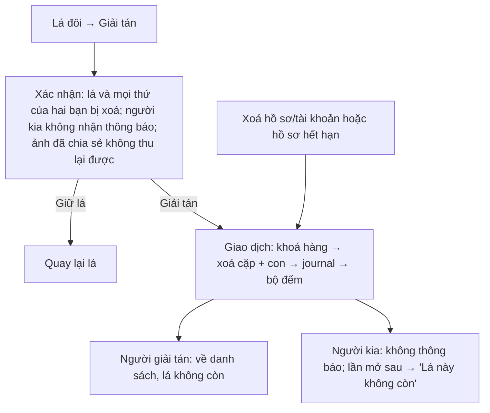

# G54 — Giải tán lá đôi im lặng và xoá dữ liệu cặp

> Trạng thái: nháp 26/10/2026, chờ owner duyệt. Không code ở giai đoạn này.
> Nguồn: [PRD Tri Kỷ](../../foundation/game-line/tri-ky-prd.md) §4 bước 8, N5; [SRS](../../foundation/game-line/tri-ky-srs.md) FR-TK-080–086, §8. Dùng lại erasure journal P07 (`docs/legal/store-privacy-data-map.md`).

## 1. User story

Là một thành viên của cặp Tri Kỷ, tôi muốn giải tán lá đôi bất kỳ lúc nào mà người kia không nhận thông báo "bạn đã bị xoá", để rời đi nhẹ nhàng và dữ liệu của hai đứa thật sự được xoá.

## 2. Mục tiêu và ranh giới

**Trong phạm vi:** nút giải tán và xác nhận; xoá cứng lá, yêu cầu chia sẻ, lượt đố, kỷ lục, đồng ý theo cặp; erasure journal; màn "Lá này không còn" đồng nhất; cascade khi xoá hồ sơ; dựng lại khi rút giờ/nơi sinh; hoà giải sau restore.

**Ngoài phạm vi:** thu hồi ảnh đã chia sẻ ra ngoài; chặn (G51, có thể làm sau khi giải tán); thông báo cho người kia.

## 3. Actor, điều kiện và output

- **Actor:** bất kỳ thành viên nào.
- **Output:** không còn hàng nào của cặp trong `tri_ky_pairs`, `tri_ky_share_requests`, `tri_ky_quiz_rounds`; một dòng journal `tri_ky_dissolved` (HMAC của `pair_id`, không nội dung); bộ đếm `pair_dissolved_lt30d` hoặc `pair_dissolved_ge30d`.

## 4. Luồng

## 5. UI/UX

| Màn | Nội dung |
|---|---|
| Xác nhận | Copy PRD §5 "Giải tán lá này?…"; nút "Giải tán" và "Giữ lá" cùng kích thước; không màu đỏ báo động, không câu gây áy náy |
| Sau giải tán | Về danh sách; một dòng nhẹ "Đã giải tán." chỉ cho người bấm; gợi ý tuỳ chọn "Không nhận lời mời Tri Kỷ từ người này nữa" |
| Người kia | Lá biến khỏi danh sách; mở link cũ/hộp thư cũ → "Lá này không còn." |

Màn "Lá này không còn." giống hệt khi lá mất vì xoá hồ sơ, hồ sơ hết hạn hay ID không tồn tại.

## 6. Business rules

1. Giải tán = rút đồng ý `tri-ky-pair-v1`; không có trạng thái trung gian.
2. Một giao dịch: `SELECT … FOR UPDATE` hàng cặp; xoá yêu cầu chia sẻ, lượt đố, cặp (FK cascade); ghi journal; tăng bộ đếm theo tuổi lá (bucket < 30 ngày / ≥ 30 ngày, tính tại thời điểm xoá, không lưu ngày tạo).
3. Không outbox, không hộp thư, không push cho bất kỳ ai.
4. Idempotent: thành viên thứ hai gọi giải tán nhận cùng phản hồi; không lộ ai giải tán trước (FR-TK-082).
5. Xoá hồ sơ khách/tài khoản của một thành viên cascade xoá mọi cặp có người đó (FR-TK-084).
6. Rút giờ/nơi sinh: không giải tán, mà dựng lại ở độ chính xác mới (FR-TK-085, G52).
7. Sau restore, journal chạy lại để lá đã giải tán không sống lại (P07).
8. Copy không hứa xoá ngay mọi bản sao; nói rõ ảnh đã chia sẻ không thu lại được.
9. Lời mời đã `accepted` dẫn tới cặp này không còn dùng được; hàng lời mời theo hạn 30 ngày sau trạng thái cuối (SRS §8) và không chứa nội dung lá.

## 7. Dữ liệu và API

`POST /v1/tri-ky/pairs/{id}/dissolve` (SRS §12). Erasure kind mới `tri_ky_dissolved` (thêm vào `ErasureKind`).

## 8. Acceptance Criteria

- **G54-AC01:** Given một thành viên xác nhận giải tán, When giao dịch xong, Then không còn hàng `tri_ky_pairs`, `tri_ky_share_requests`, `tri_ky_quiz_rounds` của cặp và có đúng một dòng journal `tri_ky_dissolved` (T-TK-07).
- **G54-AC02:** Given giải tán, When kiểm outbox, hộp thư, push, Then không có mục nào được tạo cho ai (T-TK-08).
- **G54-AC03:** Given người kia mở lá sau khi bị giải tán, When gọi API, Then nhận 404 giống hệt với `pair_id` ngẫu nhiên và thấy "Lá này không còn."
- **G54-AC04:** Given cả hai cùng bấm giải tán gần như cùng lúc, When race, Then một giao dịch xoá, giao dịch kia trả cùng phản hồi thành công; không ai biết ai bấm trước.
- **G54-AC05:** Given một thành viên xoá hồ sơ khách/tài khoản, When cascade chạy, Then mọi cặp, lời mời đang chờ, yêu cầu, lượt đố của người đó bị xoá (T-TK-16).
- **G54-AC06:** Given backup trước khi giải tán được restore, When journal chạy lại, Then lá đã giải tán không đọc được (T-TK-17, operator).
- **G54-AC07:** Given màn xác nhận, When đọc, Then có câu ảnh đã chia sẻ không thu lại được và không có câu gây áy náy hay đếm ngược.
- **G54-AC08:** Given bộ đếm giải tán, When kiểm, Then không có ID, ngày tạo hay tên; chỉ bucket tuổi lá (T-TK-19).
- **G54-AC09:** Given log ứng dụng trong lúc giải tán, When kiểm, Then không có `pair_id` thô, tên hiển thị hay nội dung lá (T-TK-10).
- **G54-AC10:** Given thành viên rút giờ sinh, When mở lá, Then lá được dựng lại ở độ chính xác thấp hơn, không giữ bản cũ.

## 9. Edge cases

| Tình huống | Xử lý |
|---|---|
| Giải tán khi yêu cầu chia sẻ đang chờ | Yêu cầu bị xoá cùng; người kia không thấy gì thêm |
| Giải tán khi lượt đố đang mở | Lượt và câu trả lời bị xoá |
| Mạng rớt sau khi gửi giải tán | Retry idempotent; UI không hiện lá cho tới khi server xác nhận |
| Cleanup bị chặn bởi việc khác | Giải tán là xoá đồng bộ trong request, không chờ job |
| Người kia đang mở lá đúng lúc | Lần tải sau 404; dữ liệu trong bộ nhớ máy bị bỏ khi điều hướng |

## 10. Test matrix

Giải tán bởi A/B; race hai bên; retry; cascade xoá hồ sơ; rút giờ sinh; journal + restore rehearsal; không thông báo; IDOR; log canary; bộ đếm.

## 11. Analytics

`pair_dissolved_lt30d`, `pair_dissolved_ge30d` (guardrail PRD §6). Không thêm gì.

## 12. Definition of Done

- G54-AC01–AC10 pass; T-TK-07, T-TK-08, T-TK-16, T-TK-17, T-TK-19 pass.
- Restore rehearsal trên PostgreSQL thật với role backend chứng minh lá đã giải tán không sống lại (operator, như chart-synthesis runbook).
- **Riêng tư/store:** chính sách quyền riêng tư, lời giải thích trong app và data map mô tả đúng: xoá khi giải tán, cascade khi xoá hồ sơ, sao lưu được hoà giải bằng journal, ảnh ra ngoài không thu lại; Data Safety khai "người dùng có thể yêu cầu xoá dữ liệu".
- `docs/operations/backup-restore-and-deletion-reconciliation.md` ghi kiểu journal mới (follow-up).
- Luật sư trả lời Q-L4 (xoá phần lá của người kia không cần đồng ý của họ, không thông báo).

## 13. Phụ thuộc, riêng tư và evidence

- **Phụ thuộc:** G52; erasure journal P07; cascade guest/account erasure.
- Evidence: `[Pending] restore rehearsal`, `[Pending] counsel Q-L4`.

## 14. Bàn giao theo AGENTS.md

Nguồn: PRD/SRS Tri Kỷ, `erasure_journal/journal.py`, store data map (P07), radar spec §6 (ghi chú trung thực về xoá vật lý), ghi chú tri kỷ (rời đi im lặng là suy luận, chưa có tiền lệ được dẫn nguồn). Phát hiện đã sửa: không lộ ai giải tán; màn cuối đồng nhất. Rủi ro: người kia vẫn nhận ra lá biến mất (R4). AC/DoD còn thiếu: toàn bộ.
