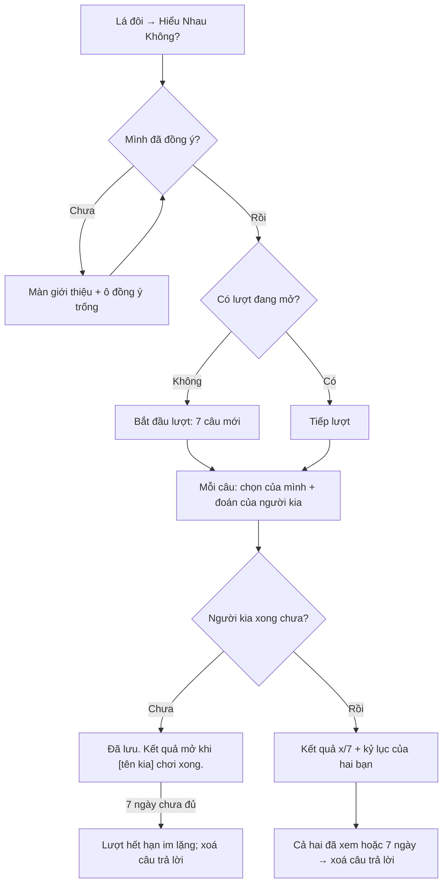

# G55 — Hiểu Nhau Không? (trò đố của cặp Tri Kỷ)

> Trạng thái: nháp 26/10/2026, chờ owner duyệt. **Sau MVP** (TK-11, đúng báo cáo 26/10). Không code ở giai đoạn này.
> Nguồn: [PRD Tri Kỷ](../../foundation/game-line/tri-ky-prd.md) §4 bước 9, D5, TK-5, TK-6; [SRS](../../foundation/game-line/tri-ky-srs.md) FR-TK-100–108, §6.4. Nguyên tắc có test: không streak, không coin/XP, không áp lực quay lại (`apps/web/src/shared/ui/companion/growth.test.ts`).

## 1. User story

Là một thành viên của cặp Tri Kỷ, tôi muốn chơi 7 câu vui để xem hai đứa hiểu nhau tới đâu và thử phá kỷ lục của chính hai đứa, mà không bị so với cặp nào khác và không bị nhắc phải quay lại.

## 2. Mục tiêu và ranh giới

**Trong phạm vi:** đồng ý `tri-ky-quiz-v1` từng người; bắt đầu lượt; trả lời cho mình và đoán người kia; chơi không đồng bộ; kết quả "x/7" của cặp; kỷ lục của cặp; xoá câu trả lời; tắt trò đố.

**Ngoài phạm vi:** điểm riêng từng người; "ai hiểu ai hơn"; so với cặp khác; bảng xếp hạng; nhắc, push, đếm ngược, cooldown hiển thị; chữ tự do; câu do người dùng tạo; AI.

## 3. Actor, điều kiện và output

- **Actor:** hai thành viên của cặp `active`.
- **Điều kiện:** cả hai đã đồng ý `tri-ky-quiz-v1` cho cặp này; không có lượt nào đang mở.
- **Output:** `tri_ky_quiz_rounds` (`open → completed/expired`); `quiz_best_score` và `quiz_best_month` trên cặp khi có kỷ lục mới.

## 4. Luồng

## 5. UI/UX

| Màn | Nội dung (copy nháp PRD §5) |
|---|---|
| Giới thiệu | "7 câu vui. Bạn trả lời cho mình và đoán câu của [tên kia]. Hai bạn chỉ so với kỷ lục của chính mình." + ô đồng ý trống |
| Câu hỏi | Một câu, 3–5 lựa chọn; hai phần "Bạn chọn" và "Bạn đoán [tên kia] chọn"; tiến độ "3/7" là vị trí câu, không phải điểm |
| Chờ | "Đã lưu. Kết quả mở khi [tên kia] chơi xong." Không đếm ngược, không nút "nhắc bạn ấy" |
| Kết quả | "Lần này hai bạn hiểu nhau 5/7 câu. Kỷ lục của hai bạn: 6/7." Từng câu: lựa chọn của hai người, dấu "hiểu nhau" cho câu được tính. Không điểm riêng, không "bạn đoán đúng 6, [tên kia] đoán đúng 4" |
| Bằng/thấp hơn kỷ lục | "Kỷ lục vẫn là 6/7. Lượt sau có câu mới." Không câu gây áy náy |
| Cài đặt cặp | "Tắt Hiểu Nhau Không?" → xoá lượt đang mở và kỷ lục |

Không confetti, không huy hiệu, không bộ đếm số lượt, không "mỗi tháng".

## 6. Business rules

1. Mỗi người đồng ý riêng `tri-ky-quiz-v1` cho từng cặp; rút → xoá lượt đang mở và kỷ lục, ghi journal `tri_ky_quiz_cleared`.
2. Một lượt đang mở mỗi cặp; ai bắt đầu cũng được.
3. 7 câu rút từ ngân hàng đã duyệt (≥ 28 câu, phiên bản cố định), không trùng bộ câu lượt trước của cặp.
4. Ngân hàng chỉ có chủ đề vô hại (món ăn khuya, bài hát nghe lặp, kiểu nghỉ ngơi, đồ uống ưa thích, cách đi chơi cuối tuần…); loại ngoại hình, sức khoẻ, tình dục, tiền, gia đình, tôn giáo, vùng miền, chính trị, người thật có tên, rượu bia, yêu đương, "ai toxic".
5. Điểm chung `x/7`; một câu được tính theo TK-5 (mặc định: cả hai cùng đoán đúng câu của nhau). Server không lưu và không trả điểm riêng.
6. Kỷ lục chỉ tăng; lưu `quiz_best_score` (0–7) và `quiz_best_month` (tháng/năm).
7. Câu trả lời mã hoá; xoá khi cả hai đã xem kết quả hoặc 7 ngày sau khi hoàn tất, cái nào trước.
8. Lượt chưa đủ hai người sau 7 ngày → `expired`, xoá câu trả lời, không tính điểm, không thông báo.
9. Không push, không hộp thư nhắc; chỉ một chấm nhỏ trong màn lá đôi khi có lượt đang chờ mình.
10. Không chơi lại để "cày": mỗi lượt có câu mới; không giới hạn thời gian hiển thị (TK-6).

## 7. Dữ liệu và API

Bảng `tri_ky_quiz_rounds`; cột quiz trên `tri_ky_pairs` (SRS §6.2, §6.4). Endpoint quiz ở SRS §12.

## 8. Acceptance Criteria

- **G55-AC01:** Given một thành viên chưa đồng ý, When mở trò đố, Then ô `tri-ky-quiz-v1` trống và không có lượt nào bắt đầu được.
- **G55-AC02:** Given lượt mới, When rút câu, Then 7 câu thuộc ngân hàng đã duyệt, không trùng bộ câu lượt trước của cặp.
- **G55-AC03:** Given gửi câu trả lời, When payload có chữ tự do hoặc id không thuộc câu, Then 422.
- **G55-AC04:** Given cả hai đã trả lời, When tính, Then chỉ có một điểm chung `x/7` theo TK-5; API không có trường điểm riêng (T-TK-20).
- **G55-AC05:** Given kết quả cao hơn kỷ lục, When lưu, Then `quiz_best_score` tăng; thấp hơn hoặc bằng thì không đổi.
- **G55-AC06:** Given cả hai đã xem kết quả, When cleanup chạy, Then `answers_ciphertext` bị xoá; chỉ còn kỷ lục.
- **G55-AC07:** Given chỉ một người trả lời trong 7 ngày, When hết hạn, Then lượt `expired`, câu trả lời bị xoá, không có thông báo nào.
- **G55-AC08:** Given mọi màn trò đố, When rà, Then không có streak, huy hiệu, đếm ngược, "mỗi tháng", "quay lại", so với cặp khác (T-TK-18).
- **G55-AC09:** Given một thành viên tắt trò đố, When xác nhận, Then lượt đang mở và kỷ lục bị xoá, có journal `tri_ky_quiz_cleared`.
- **G55-AC10:** Given giải tán cặp, When xong, Then mọi dữ liệu trò đố của cặp bị xoá (G54-AC01).
- **G55-AC11:** Given log, analytics, push, When kiểm, Then không có câu trả lời, điểm hay kỷ lục.

## 9. Edge cases

| Tình huống | Xử lý |
|---|---|
| Hai người bấm "Bắt đầu" cùng lúc | Một lượt được tạo; người kia vào cùng lượt |
| Ngân hàng hết câu mới cho cặp | Rút lại câu cũ nhất, không báo "hết câu" |
| Lá dựng lại giữa lượt | Không ảnh hưởng lượt đố |
| Một người rút đồng ý giữa lượt | Lượt bị xoá; người kia thấy "Lượt này không còn." |
| Kết quả 0/7 | Copy trung tính "Lượt sau có câu mới."; không câu chê |

## 10. Test matrix

Đồng ý/không đồng ý; bắt đầu song song; trả lời sai định dạng; tính điểm theo TK-5 với fixture; kỷ lục tăng/không; xoá sau xem; hết hạn; tắt; giải tán; log/analytics canary; UI không có bộ đếm.

## 11. Analytics

Không có bộ đếm cho trò đố ở bản đầu. Nếu cần sau này: chỉ số lượt hoàn tất theo ngày, không điểm.

## 12. Definition of Done

- G55-AC01–AC11 pass; T-TK-18, T-TK-20 pass; `growth.test.ts` vẫn xanh.
- Ngân hàng ≥ 28 câu và copy được owner duyệt; rà theo danh sách chủ đề loại trừ; playtest giấy với 3–5 cặp (Writer F) cho thấy không ai thấy bị "chấm".
- Quyết định TK-5, TK-6, TK-11 đã chốt.
- **Riêng tư/store:** data map và nhãn store thêm câu trả lời đố (lựa chọn, linked, App Functionality, xoá sau khi xem) và kỷ lục; chính sách quyền riêng tư nói rõ hạn xoá; luật sư trả lời Q-L5.

## 13. Phụ thuộc, riêng tư và evidence

- **Phụ thuộc:** G52; ngân hàng câu đã duyệt; TK-5, TK-6, TK-11.
- Rủi ro bất đối xứng (R3): người chơi vẫn suy ra được ai đoán sai từ câu của mình; giảm bằng điểm chung và copy trung tính.
- Evidence: `[Pending] question bank approval`, `[Pending] paper playtest`, `[Pending] counsel Q-L5`.

## 14. Bàn giao theo AGENTS.md

Nguồn: PRD/SRS Tri Kỷ, báo cáo 26/10 (bước 6, D5), kế hoạch 23/10 (nguyên tắc không streak/coin/XP), ghi chú tri kỷ (Nesi & Prinstein về so sánh xã hội). Phát hiện đã sửa: bỏ "chơi lại mỗi tháng"; bỏ điểm riêng từng người; không nhắc. Rủi ro: cách tính TK-5 có thể làm điểm thấp và gây buồn; cần playtest. AC/DoD còn thiếu: toàn bộ.
